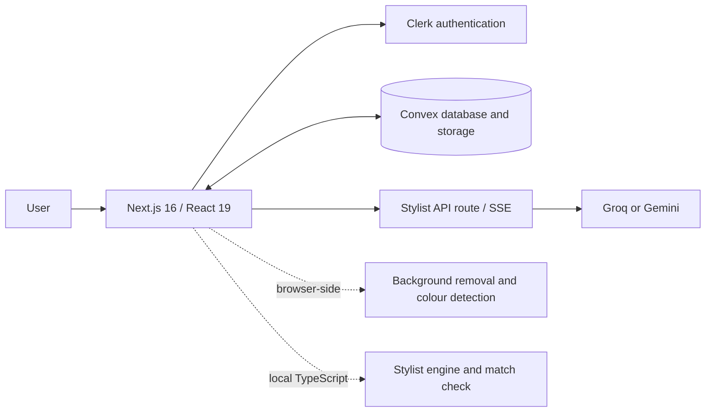

fitcheck.lite

  <strong>A free digital wardrobe that helps you decide what to wear.</strong> 
  Organize the clothes you own, build outfits on a digital dress form, check how a look works together,
  and chat with an AI stylist grounded in your wardrobe.

  <a href="https://fitcheck-lite-pi.vercel.app/"><strong>Live demo</strong></a> ·
  <a href="#preview-gallery">Preview gallery</a> ·
  <a href="#how-it-works">How it works</a> ·
  <a href="#run-locally">Run locally</a>

  
  
  
  
  
  

Preview note: The gallery images in this repository are illustrative portfolio mockups, not captured screenshots of the deployed application. Replace them with real screenshots from the live app when available. The live demo and source code are linked above.

Why I built it
I kept standing in front of a full wardrobe with nothing to wear. At college, it was worse: limited time in the morning, not much mirror space, and the same few outfits on repeat while other clothes stayed untouched.

I wanted a simple place to keep track of what I own, experiment with combinations before getting dressed, and get useful suggestions without needing to buy more clothes. That idea became fitcheck.lite.
What it does
Feature	What it does
Digital wardrobe	Add clothing photos, remove backgrounds in the browser, detect the main colour, and keep the details organized.
Outfit studio	Assemble a look on a digital dress form. Replace or remove individual pieces, save combinations, and mark outfits as worn.
Outfit match check	Score an assembled outfit out of 100 using formality, colour harmony, season, and completeness; return practical suggestions for improvement.
Rule-based stylist	Rank combinations from the user's own wardrobe based on occasion and temperature, while giving extra weight to pieces worn less often. This engine does not require an AI API.
AI stylist chat	Ask questions about what to wear. Responses stream to the browser and use wardrobe context and recommendations.
Wear tracking	Update wear counts when an outfit is marked as worn, making it easier to notice underused pieces.
Product polish	Light and dark themes, command palette, responsive layout, mobile navigation, keyboard-friendly controls, and reduced-motion support.

Preview gallery
The images below are illustrative UI concepts created for the repository presentation. They are not captured screenshots of the deployed application and should not be represented as such. Replace them with real captures from the live app whenever possible.
Landing page	Live styling demo
	

Add clothes	Wardrobe
	

Outfit studio	Match check
	

Saved outfits	AI stylist chat
	

Command palette	Mobile wardrobe
	

Mobile outfit studio	Light theme
	

How it works

The stylist engine
The recommendation engine in src/lib/stylist.ts is plain TypeScript and does not need a network request. Based on the wardrobe, occasion, and temperature, it:
1. Scores clothing items for formality, seasonal suitability, and wear frequency.
2. Builds supported outfit combinations, such as a top with bottoms or a dress, and adds shoes or outerwear when appropriate.
3. Evaluates colour harmony between pieces, allowing compatible neutrals and penalizing combinations the rules classify as clashes.
4. Returns ranked looks with explanations for why each combination was selected.
The rateOutfit match-check logic reuses these scoring ideas to evaluate an outfit assembled manually.
The AI layer
The AI integration in src/lib/ai.ts abstracts the supported providers (Groq and Gemini). The stylist API streams responses using server-sent events. Provider/model fallback is used so that a retired or unavailable model does not automatically make the rest of the application unusable. API credentials remain on the server.
Engineering decisions
- Free-first architecture: the core recommendation engine runs without an AI API. AI is an optional conversational layer rather than a dependency for basic outfit suggestions.
- Browser-side image processing: background removal is performed on-device with @imgly/background-removal, avoiding a separate hosted background-removal service.
- User-scoped data: backend functions resolve the authenticated user and scope wardrobe and outfit operations to that user. The project includes automated tests for cross-user access boundaries.
- Input and API safeguards: inputs are validated server-side; the stylist route requires an authenticated session, trims untrusted text, and applies per-user rate limiting.
- Provider resilience: the AI wrapper tries configured models in order and can return a readable fallback message when providers are unavailable.
- Accessible interaction: semantic controls, labels, visible focus, live match-result announcements, and reduced-motion support are part of the interface.
Tech stack
Area	Technology
Application	Next.js 16 App Router, React 19, TypeScript
Styling	Tailwind CSS 4, CSS-variable design tokens, Geist fonts
Authentication	Clerk
Backend and storage	Convex database, file storage, and realtime queries
Browser ML	@imgly/background-removal
AI providers	Groq (streaming) and Gemini (supported provider)
Tests	node:test + tsx, Vitest, and convex-test
Hosting	Vercel and Convex Cloud

Run locally
Requirements: Node.js 20.9 or newer, plus configured Clerk, Convex, and Groq credentials. See [`SETUP-GUIDE.md`](SETUP-GUIDE.md) for the full walkthrough and check .env.example for the environment variable names required by this project.
npm install
cp .env.example .env.local
# Add the required values to .env.local

# Terminal 1
npx convex dev

# Terminal 2
npm run dev
Open http://localhost:3000.
Useful commands
Command	Purpose
npm run dev	Start the Next.js development server.
npx convex dev	Start Convex development and sync backend functions/schema.
npm test	Run the engine, match-check, and AI-streaming tests.
npm run test:backend	Run backend validation and security tests.
npm run lint	Run the linter.
npm run typecheck	Check TypeScript types.
npm run build	Create a production build.

The repository's original project notes report 31 passing tests. Run the test commands above on the current commit to confirm the latest count before relying on that number in a résumé or application.

Honest limitations
- The outfit preview is a flat dress-form collage, not a photorealistic image of the user wearing the clothes.
- Colour and formality ratings are rule-based recommendations, not objective fashion judgments. The scoring rules can be tuned in the code.
- Free AI providers have rate limits and availability can change. Basic wardrobe and rule-based styling features remain separate from the AI chat layer.
Roadmap
- [ ] Weather by city and a week-ahead outfit planner
- [ ] Share an outfit as an image
- [ ] Packing-list generator for trips
- [ ] Optional realistic try-on as a separately funded feature
Credits
Inspired by Sonny Sangha's AI wardrobe tutorial. fitcheck.lite is an independent implementation with its own code, design, architecture, features, and free-first approach.
Author
Kidus Yosef · Software Engineering student
LinkedIn · GitHub
License
MIT. See LICENSE.
