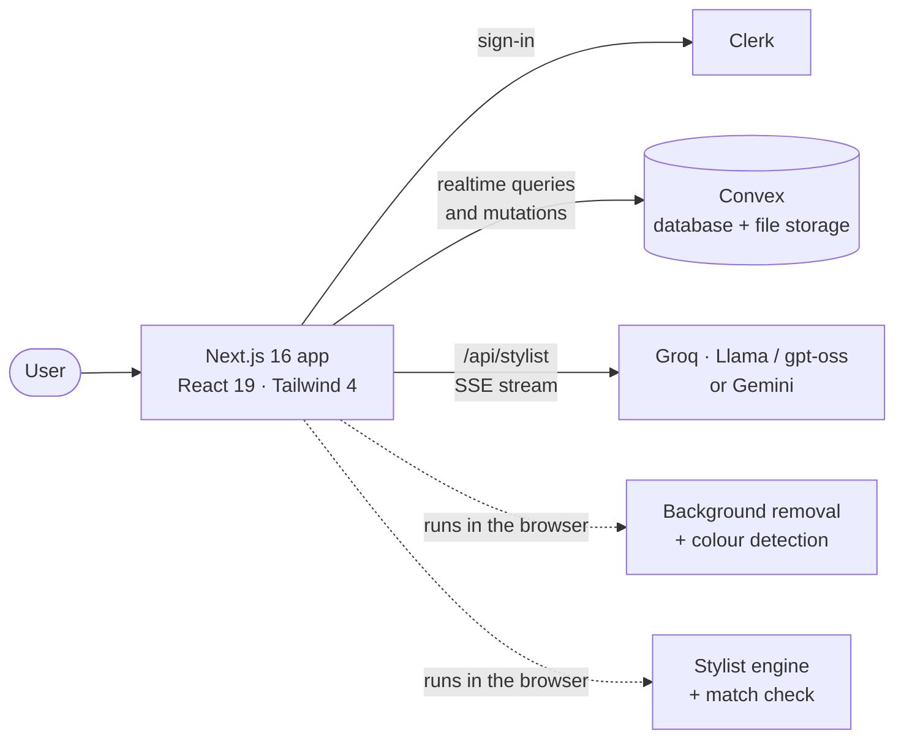

<p align="center">
  
</p>

<h1 align="center">fitcheck.lite</h1>

<p align="center">
  <b>A free digital wardrobe that tells you what to wear.</b><br/>
  Photograph your clothes, build outfits on a dress form, check whether a look goes together,<br/>
  and talk to a streaming AI stylist that knows what is actually in your closet.
</p>

<p align="center">
  <a href="https://YOUR-LIVE-LINK"><b>Live demo</b></a> ·
  <a href="#screenshots">Screenshots</a> ·
  <a href="#how-it-works">How it works</a> ·
  <a href="#run-it-locally">Run it locally</a>
</p>

<p align="center">
  
  
  
  
  
  
  
</p>

---

## Why I built this

I kept standing in front of a full wardrobe with nothing to wear. At college it was worse: no time,
no mirror space, and the same three outfits on repeat while half my clothes sat untouched.

So I built the tool I wanted: put every piece in one place, see outfits before getting dressed, get a
straight answer on whether two things go together, and ask a stylist who has actually seen my closet.

## What it does

| | |
|---|---|
| **Digitise your closet fast** | Drop a photo and the background is removed *in your browser* (on-device ML). The main colour is detected for you. Confirm the details and save. |
| **Outfit studio** | Build looks on a dress form with replace and remove controls for every slot. Save them and mark them as worn. |
| **"Does it go together?"** | A live match check scores the outfit out of 100 on formality, colour harmony, season and completeness, and tells you exactly what to fix (for example, which two colours clash). |
| **Stylist engine** | Pick an occasion and the temperature. It ranks every combination from *your* clothes and favours pieces you rarely wear. No AI needed, so it is free and instant. |
| **AI stylist chat** | Ask anything about your outfits. The reply **streams in word by word** and is grounded in your real wardrobe and the engine's suggestions. |
| **Wear tracking** | Every "I wore this today" updates wear counts, so you can see what is gathering dust. |
| **Polish** | Light and dark theme with no flash, a ⌘K command palette, a responsive layout with a mobile tab bar, keyboard-friendly controls, reduced-motion support. |

## Screenshots

> **Try the live demo first:** the landing page has an interactive version of the stylist engine. Drag the
> temperature slider and watch the outfits change, no sign-in needed.

| Landing page | Live styling demo |
|---|---|
|  |  |

| Add clothes (background removed on-device) | Wardrobe |
|---|---|
|  |  |

| Outfit studio with the match check | Saved outfits |
|---|---|
|  |  |

| AI stylist, streaming | ⌘K command palette |
|---|---|
|  |  |

| Mobile: wardrobe | Mobile: outfit studio | Light theme |
|---|---|---|
|  |  |  |

## How it works



**The stylist engine** (`src/lib/stylist.ts`) is plain TypeScript with no network calls. It takes the
wardrobe, an occasion and a temperature, then:

1. Scores each piece on formality fit, season fit and how rarely it has been worn.
2. Builds every sensible combination (top + bottom or a dress, shoes, and a jacket when it is cold).
3. Adds a colour-harmony score for every pair, so neutrals pair freely and clashing hues are penalised.
4. Returns the best looks, each with reasons it works.

**The match check** (`rateOutfit`) uses the same building blocks on any outfit you assemble yourself.

**The AI layer** (`src/lib/ai.ts`) is a provider-agnostic wrapper over Groq and Gemini. It streams
server-sent events to the browser, tries a list of current free models in order (so a retired model does
not break the app), and keeps the API key on the server.

## Engineering decisions worth knowing

- **Free by design.** Image processing runs on the user's device, and the core stylist needs no AI.
  AI is an optional layer on top, so the app keeps working if a free quota runs out.
- **Security.** Every backend function resolves the signed-in user and scopes data to them. Automated
  tests prove one user cannot read, edit or delete another user's items or outfits. Inputs are validated
  server-side; the AI route requires a session, trims untrusted text and rate-limits each user.
- **Resilience.** Free AI model lineups change often (one model I started with was retired mid-project).
  The wrapper falls back across models and shows a plain-English message if everything is unavailable.
- **Accessibility and UX.** Real buttons and labels, visible focus, `aria-live` match results, a
  theme with no flash on load, and motion that respects `prefers-reduced-motion`.

## Tech stack

| Area | Choice |
|---|---|
| Framework | Next.js 16 (App Router), React 19, TypeScript |
| Styling | Tailwind CSS 4 with CSS-variable design tokens, Geist fonts |
| Auth | Clerk |
| Backend | Convex (database, file storage, realtime queries) |
| On-device ML | `@imgly/background-removal` |
| AI | Groq (streaming), Gemini supported |
| Tests | `node:test` + `tsx` (engine, match check, AI streaming), `vitest` + `convex-test` (backend) |
| Hosting | Vercel + Convex Cloud |

## Run it locally

You need Node 20.9+, and free accounts at Clerk, Convex and Groq. The full beginner walkthrough is in
[`SETUP-GUIDE.md`](SETUP-GUIDE.md). The short version:

```bash
npm install
cp .env.example .env.local      # then fill in your keys
npx convex dev                  # terminal 1
npm run dev                     # terminal 2 -> http://localhost:3000
```

| Command | What it does |
|---|---|
| `npm run dev` | Start the app |
| `npx convex dev` | Sync backend functions and schema |
| `npm test` | Engine, match check and AI streaming tests |
| `npm run test:backend` | Backend security and validation tests |
| `npm run lint` / `npm run typecheck` | Static checks |
| `npm run build` | Production build |

## Honest limits

- The "try-on" is a flat dress-form collage, not a generated photo of you. Realistic AI try-ons cost money
  per image, so they are deliberately out of scope for a free app.
- Colour and formality scoring is rule-based. It is a helpful opinion, not fashion gospel, and it is
  easy to tune in one file.
- The free AI tier has provider rate limits. When it is exhausted, everything except the chat keeps working.

## Roadmap

- [ ] Weather by city and a week-ahead outfit planner
- [ ] Share a look as an image
- [ ] Packing list generator for trips
- [ ] Optional realistic try-on behind a paid plan

## Credits

Inspired by Sonny Sangha's AI wardrobe tutorial. This is an independent implementation with its own code,
design, free-first architecture and tests.

## Author

**Kidus Yosef**, software engineering student. [LinkedIn](https://www.linkedin.com/in/YOUR-HANDLE) · [GitHub](https://github.com/kid-yP)

## License

MIT. See [`LICENSE`](LICENSE).
